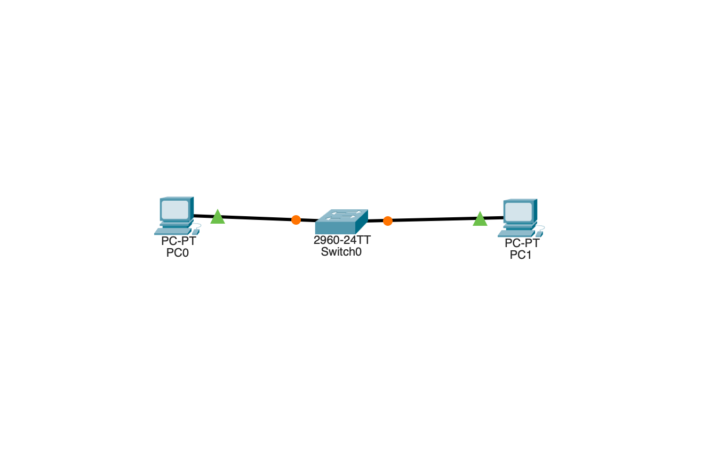

# Lab 1: Two PCs and a Switch

My first Cisco Packet Tracer lab: two PCs connected through a switch, each given a static IP address, to confirm they can communicate.

## Goal

- Connect two PCs through a switch
- Assign static IP addresses in the same network
- Verify connectivity with `ping`

## Topology

- 1 switch
- 2 PCs, each connected to the switch

## Addressing Table

| Device | IP Address   | Subnet Mask   |
|--------|--------------|---------------|
| PC0    | 192.168.1.1    | 255.255.0.0 |
| PC1    | 192.168.1.2    | 255.255.0.0 |

## Configuration Steps

1. Placed a switch and two PCs in Packet Tracer.
2. Connected each PC to the switch with a cable.
3. On each PC, opened **Desktop > IP Configuration** and entered a static IP address and subnet mask in the same network.
4. Opened the command prompt on PC1 and pinged PC0's IP address.

## Result

The ping from PC2 to PC1 succeeded, so the two PCs can communicate through the switch.

## What I Learned

- Devices on the same network can talk to each other through a switch without a router.
- Each PC needs its own unique IP address, and the addresses must be in the same network for this to work.
- `ping` is the quickest way to test whether two devices can reach each other.

## Files

- `01-two-pcs-and-switch.pkt`: the Packet Tracer lab file
- Screenshots of the topology and the successful ping
