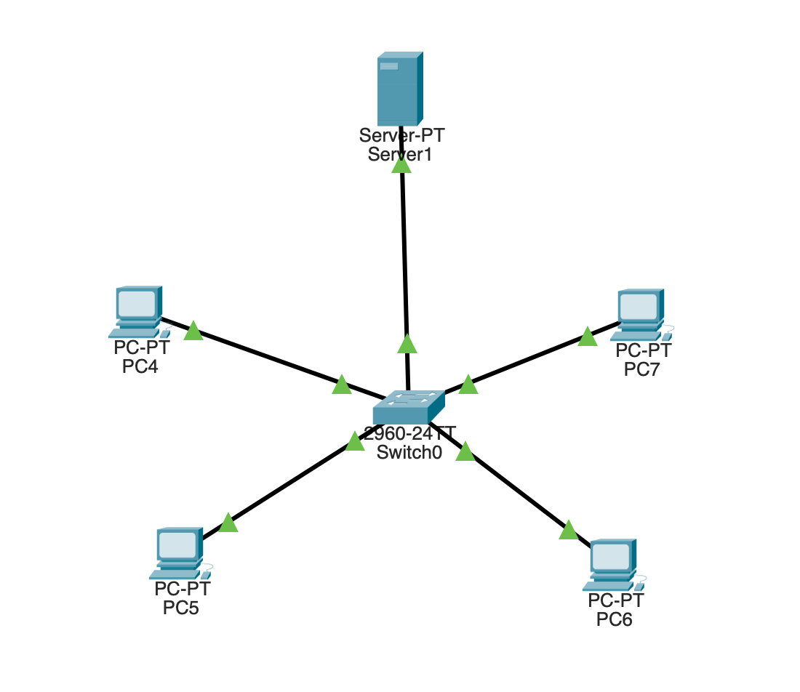
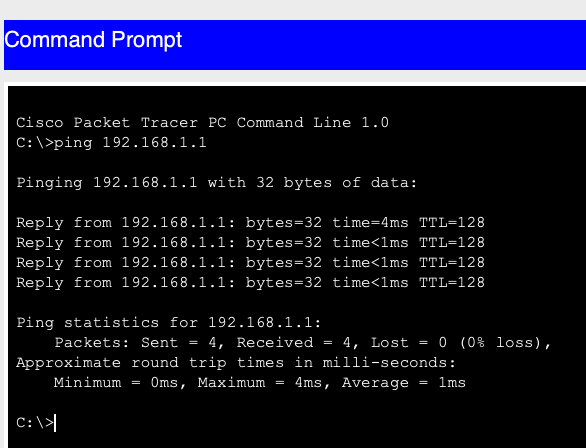
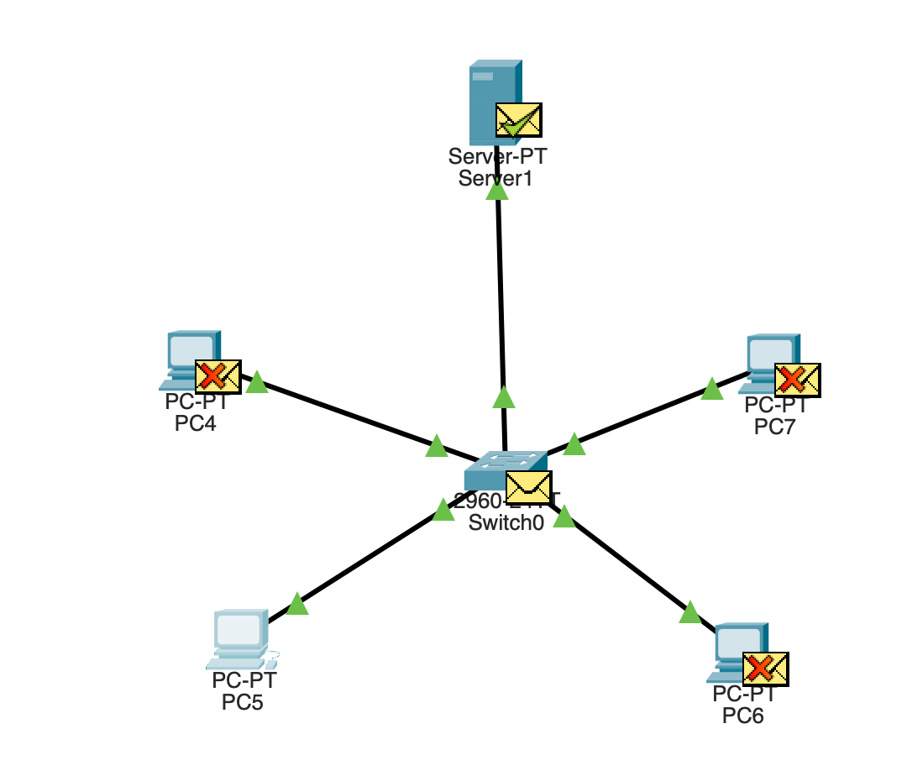

# Lab 2: DHCP Server

A small Cisco Packet Tracer lab where a server hands out IP addresses automatically (DHCP) to four PCs on one switch, followed by a few experiments to see how DHCP behaves.

## Goal

- Configure a DHCP server so PCs receive IP addresses automatically
- Verify the addresses and connectivity between PCs
- Observe the DHCP process and test how it behaves when addresses are released and when the pool runs out

## Topology

- 1 server (DHCP server)
- 1 switch
- 4 PCs, all connected to the switch
- The switch is connected to the server

## Addressing

| Device       | IP Address                  | Default Gateway | Notes                              |
|--------------|-----------------------------|-----------------|------------------------------------|
| DHCP Server  | 172.16.1.1 (static)         | 172.16.1.1      | Gateway set to the server's own IP |
| PC1 - PC4    | 172.16.1.2 - 172.16.1.5 (DHCP) | -            | Pool starts at 172.16.1.2          |

Subnet mask received by the PCs: `255.255.0.0` (the default in Packet Tracer's DHCP pool, left unchanged).

## Configuration Steps

1. Connected the 4 PCs to a switch, and the switch to the server.
2. On the server, set a static IP address of `172.16.1.1` and set the default gateway to the same address.
3. Opened the server's **Services > DHCP** tab, turned the service on, and set the **start IP address** to `172.16.1.2`.
4. Set each PC's IP configuration to **DHCP**.
5. Ran `ipconfig` on each PC to check the address it received.
6. Pinged between PCs from the command prompt to confirm connectivity.

## Results

All four PCs received addresses automatically, from `172.16.1.2` to `172.16.1.5`, and a ping from one PC to another succeeded.

## Experiments

### 1. Watching the DHCP process (DORA)

I used Packet Tracer's **Simulation mode** with the filter set to DHCP only, then switched a PC from Static to DHCP and watched the packets travel between the PC and the server. DHCP works in four steps:

1. **Discover:** the PC broadcasts a request looking for a DHCP server
2. **Offer:** the server offers an available address
3. **Request:** the PC asks to use the offered address
4. **Acknowledge:** the server confirms and the PC starts using it

### 2. Release and renew

| Command | What happened |
|---------|---------------|
| `ipconfig /release` | The PC gave its address back to the server and every value showed `0.0.0.0` |
| `ipconfig /renew` | The PC asked the server again and received an address from the pool |

### 3. Exhausting the pool

I limited the server's maximum number of users to 4 and added a fifth PC set to DHCP. The fifth PC did **not** get an IP address. All four addresses in the pool were already in use, so the server had nothing left to offer.

### 4. Subnet mask

`ipconfig` on the PCs showed a subnet mask of `255.255.0.0`. This comes from the DHCP pool settings on the server, where the default mask is `255.255.0.0`. I left it unchanged because the lab works as it is.

## What I Learned

- DHCP removes the need to configure every device by hand: the server leases out addresses from a pool, and each PC gets one through the Discover, Offer, Request, Acknowledge exchange.
- Releasing an address returns it to the server, and renewing starts the process again.
- A DHCP pool is limited. When every address is leased, new devices get no address, so pools need to be larger than the number of devices.
- The subnet mask a PC receives is decided by the server's DHCP settings, not by the PC.

## Files

- `02-dhcp-server.pkt`: the Packet Tracer lab file
- Screenshots of the topology, the `ipconfig` output, the DORA simulation and etc.
